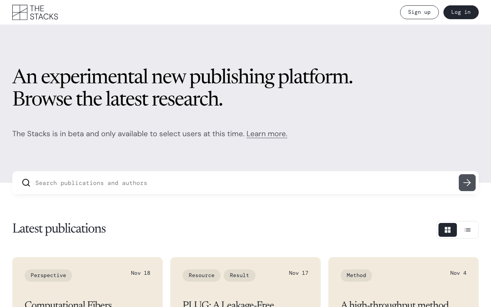

<p align="center">
  <picture>
    <source media="(prefers-color-scheme: dark)" srcset="brand-guidelines/assets/stacks-logo-light.svg">
    
  </picture>
</p>

<p align="center">
  The website for <a href="https://thestacks.org">The Stacks</a>, an open-access platform for sharing scientific work.
</p>

<p align="center">
  <a href="https://thestacks.org">Website</a> ·
  <a href="https://docs.thestacks.org/thestacks/">Documentation</a> ·
  <a href="https://api.thestacks.org/api/v1/docs">API reference</a> ·
  <a href="https://github.com/Astera-org/raven">Raven</a>
</p>

> [!IMPORTANT]
> The Stacks is a young project, and the website and this code change often.



## How it fits with Raven

The website reads all of its data from the API of [Raven](https://github.com/Astera-org/raven), the open source backend that The Stacks runs on.
See [Raven and The Stacks](https://docs.thestacks.org/thestacks/about/raven-and-the-stacks) for more.

## Try it

Run the website on your machine, with the public staging API as its data source:

```sh
git clone https://github.com/Astera-org/thestacks.git
cd thestacks
pnpm install
echo "VITE_BACKEND_URL=https://api.staging.thestacks.org" > frontend/.env
cd frontend && pnpm dev  # http://localhost:3000
```

See [`frontend/README.md`](./frontend/README.md) for more commands and how deployment works.

## What's in this repository

| Path                                           | What it is                                                   |
| ---------------------------------------------- | ------------------------------------------------------------ |
| [`frontend/`](./frontend/)                     | The website: a React Router app deployed on Vercel           |
| [`core/myst-renderer/`](./core/myst-renderer/) | MyST-to-HTML renderer used by the website                    |
| [`scripts/`](./scripts/)                       | Development scripts, such as `compare-render`                |
| [`tests/`](./tests/)                           | Playwright end-to-end, visual, and performance tests         |
| [`brand-guidelines/`](./brand-guidelines/)     | The brand guidelines page, with logos and other brand assets |

Each folder has a README with setup and usage details.

## Learn more

| I want to…                     | Go to                                                                                                             |
| ------------------------------ | ----------------------------------------------------------------------------------------------------------------- |
| Read or publish on The Stacks  | [The Stacks docs](https://docs.thestacks.org/thestacks/)                                                          |
| Build on The Stacks' data      | [API guide](https://docs.thestacks.org/thestacks/api/) and [API reference](https://api.thestacks.org/api/v1/docs) |
| Run my own publishing platform | [Raven deployer guide](https://docs.thestacks.org/raven/deployers/)                                               |
| Learn why The Stacks exists    | [About The Stacks](https://thestacks.org/about)                                                                   |

## Contributing

Astera develops The Stacks in a private repository and pushes commits here periodically.
We aren't accepting outside pull requests yet, but we welcome issues.
See [CONTRIBUTING.md](./CONTRIBUTING.md) for how the project is run and how to report bugs or security issues.

## License

BSD 3-Clause License. See [LICENSE](./LICENSE).
