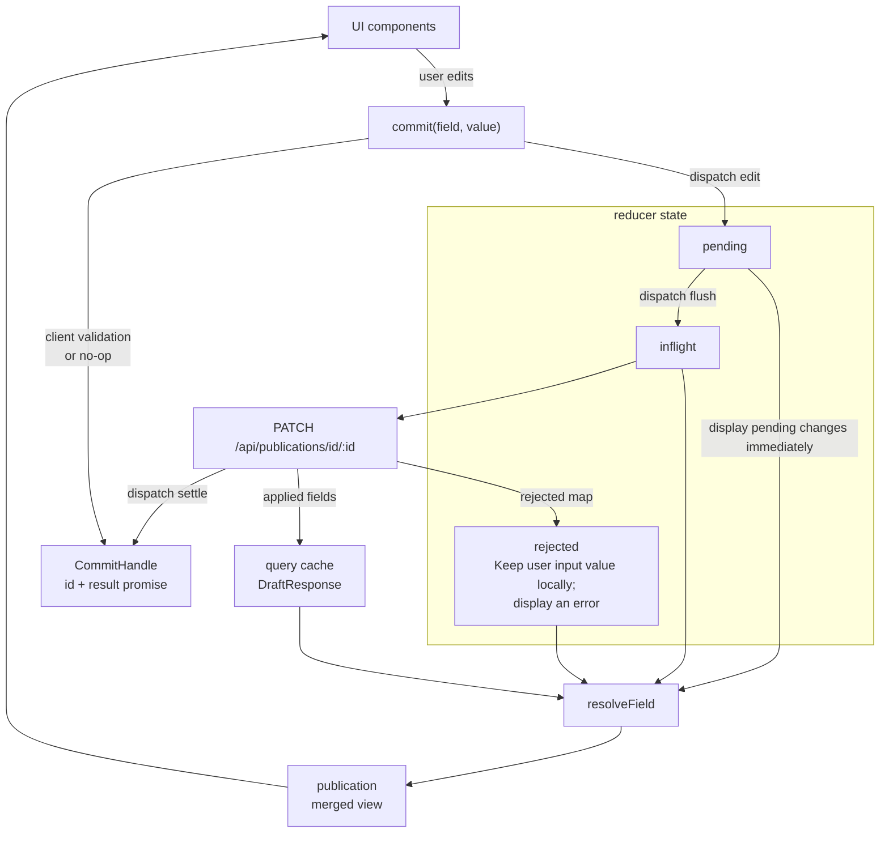
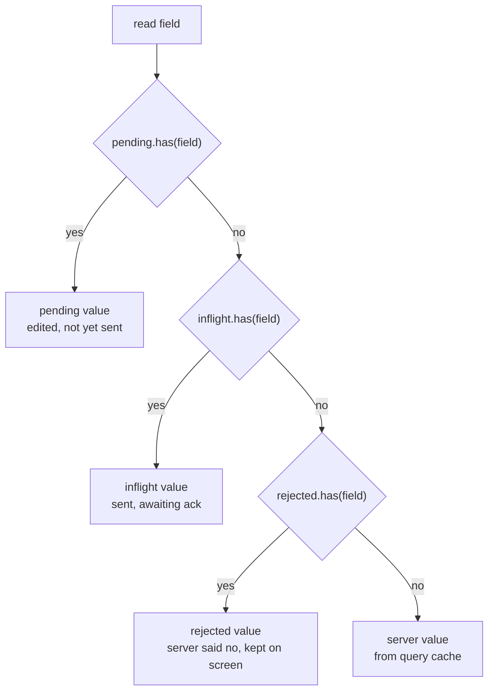
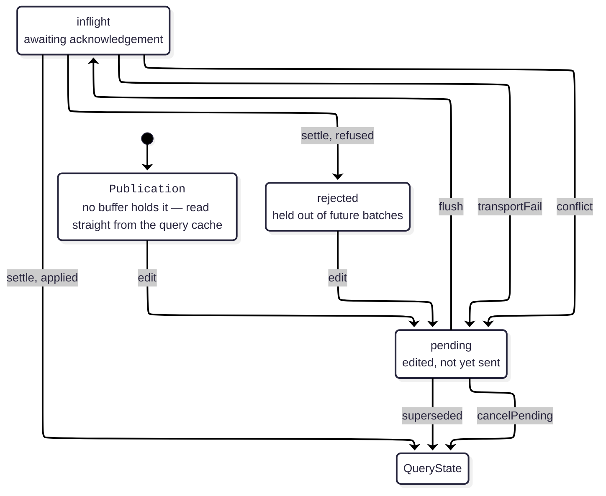
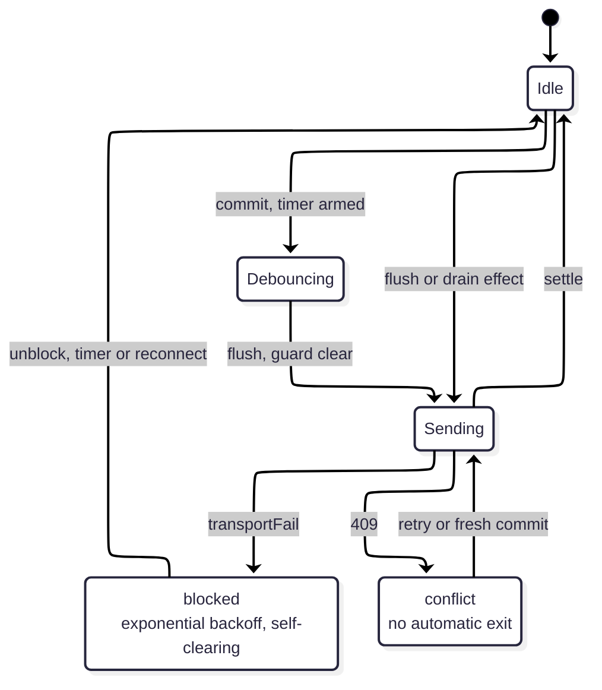

# Docs for `useEditPublication`

## Introduction

This hook is made specifically for the edit publication page.

### Purpose

On the edit page we want changes to persist automatically as a user makes changes. This brings with it a lot of complications because of the combination of synchronous (e.g. an input updating as you type) and asynchronous (persisting to the server) changes.

On top of that errors can happen both with the API (connection, auth, etc.) or with the user's input.

This hook combines the **synchronous** and **asynchronous** updates for both the **happy paths** and **error paths** for the full process of editing the publication draft.

### Concessions

A direct choice I made was to switch from using multiple endpoints to edit the publication to a single `PATCH` request. I found that using multiple endpoints where multiple requests could be in-flight and creating their own errors or passes for different parts of the publication was unwieldy at best.

That said, while this is _more_ straightforward to understand process, that doesn't mean it is trivial, hence the documentation provided here.

### Structure

The hook can be broken down into 4 main views that we'll discuss below in this document:

1. [**The value cycle**](#1-the-value-cycle) — Where the data in the `publication: Publication` variable comes from and what `commit` does to it
2. [**`resolveField`**](#2-resolvefield) — the data layer stack that resolves what data to display, making the cycle work
3. [**A single field's commit**](#3-a-single-fields-commit) — the path a commit (an incremental change to `publication`) takes through the system before it resolves in one of various `outcome`s
4. [**The reducer**](#4-the-reducer) — buffer transitions and the drain/transport loop

### Vocabulary

A handful of words recur throughout without being re-explained every time:

- **reducer** — the single `useReducer` state machine (`use-edit-publication/reducer.ts`) that owns every buffer below, plus bookkeeping like `commits`, `blocked`, and `conflict`. Nothing changes it except by `dispatch`ing a plain action object.
- **dispatch** — send an action to the reducer; it runs synchronously and produces the next state.
- **buffer** — one of the three maps the reducer holds per field — `pending`, `inflight`, `rejected` — that sit between the user's edits and the server (see [§2](#2-resolvefield)).
- **batch** — whatever was sitting in `pending` at the moment of a `flush`; it moves into `inflight` as one group and is sent in a single `PATCH`.
- **flush** — the action that moves a batch out of `pending` and into `inflight` — "send what's queued right now."
- **settle** / **settled** — a commit or field's outcome is finally known (win or lose) and won't change again. `settle` is also the specific action that turns a server response into per-field outcomes.
- **drain** — the effect that opportunistically flushes any leftover or newly-queued `pending` work the moment nothing (an in-flight batch, a block, a conflict) is stopping it, instead of waiting on the debounce timer.
- **deferred** — a `Deferred<CommitResult>`: a promise this hook can resolve itself from outside its executor, handed back as `CommitHandle.result`.
- **outstanding** — the fields a commit is still waiting on a final outcome for.

---

## 1. The Value Cycle

The UI never reads the server directly. Instead it reads an instance `publication: Publication`, which is a result of the `resolveField` function. It determines what value to display for each field based on sync and async properties.

A `commit` dispatches an edit that will immediately show the changes in `publication` for reactive performance, then it will dispatch a mutation (a TanStack Query mutation — the thing that actually fires the `PATCH`). The API answer arrives later on the slow loop, replacing the cache and draining the buffers.

The two loops are independent. The screen updates on the fast one; the
`CommitResult` (an `{ outcomes, errors }` pair — see [§3](#3-a-single-fields-commit)) resolves on the slow one.



The one thing to take from this: there is no path from the API to the UI that
skips `resolveField`. A field the user is still editing keeps its buffered value
even as the cache is replaced underneath it.

---

## 2. `resolveField`

Four layers, newest first — the three buffers plus the server value. We use `has()`
rather than `??`, because a buffered `null` (clearing a subtitle) is a real value
that must not fall through.



`rejected` sitting above the server is deliberate: a refused value stays visible so
the user can fix it, rather than snapping back to what the server has.

`server value` here means the value the query received at page load, then the updated value from any successive `PATCH` which returns the full pub's value.

---

## 3. A single field's commit

A commit is what is used to modify the publication with `onCommit`, and it tracks
the change through the sync and async processes.

Five terminal outcomes — `applied`, `superseded`, `rejected`, `abandoned`, `no-op` —
the final values a commit can settle to and never change again. Some (`no-op`,
`rejected`) can be decided synchronously inside `commit()` before the reducer is ever
touched; others (`applied`, `superseded`, `rejected`) can be the result of a server
round trip; while others (`superseded`, `abandoned`) can be a result of other async
changes that happen prior to a call to the server.

Fields settled synchronously (`rejected` by client validation, `no-op`) are seeded
straight into the commit's `outcomes` and never enter `outstanding` — so they can
never block the deferred.

Each commit creates a record:

```ts
export type CommitRecord = {
  id: CommitId;
  /** Every field the commit asked for, including client-rejected ones. */
  requested: FieldName[];
  outstanding: Set<FieldName>;
  outcomes: Partial<Record<FieldName, CommitOutcome>>;
  errors: Partial<Record<FieldName, FieldError>>;
  deferred: Deferred<CommitResult>;
  createdAt: number;
  settledAt: number | null;
};
```

As outstanding fields are settled, their outcomes and errors become available. The `deferred` result (with outcomes and errors) can also be awaited.

```mermaid
flowchart TD
  START["commit(field, value)"] --> SPEC{"FIELDS[field] exists"}
  SPEC -->|yes| PARSE{"zod validation"}

  PARSE -->|fail| CREJ(["<b><code>OUTCOME: rejected</code></b><br/>error attached<br/>never enters a buffer"])
  PARSE -->|ok| LOCK{"Previous commit for field exists<br/><code>inflight.has || rejected.has</code>"}

  SPEC -->|no| LOCK

  LOCK -->|yes| VALID["field added to <code>valid</code><br/>(this commit's map of<br/>fields that need the reducer)"]
  LOCK -->|no| EQ{"isEqual(server[field], value)"}

  EQ -->|yes| NOOP(["<b><code>OUTCOME: no-op</code></b>"])
  EQ -->|no| VALID

  NOOP --> CANCELQ{"pending.has(field)"}
  CANCELQ -->|yes| CANCEL["dispatch cancelPending<br/>the OTHER commit that owns<br/>that entry gets superseded"]
  CANCELQ -->|no| EDIT["dispatch <code>edit</code> to reducer"]
  CANCEL --> EDIT
  CREJ --> EDIT

  VALID --> EDIT
  EDIT -->|all fields settled| SYNC["set commit as resolved"]

  EDIT -->|remaining unresolved fields| PRIOR{"pending already holds field"}
  PRIOR -->|yes| SUPPRIOR(["prior commit for that field<br/><b><code>OUTCOME: superseded</code></b>"])
  PRIOR -->|no| ENTER
  SUPPRIOR --> ENTER["field enters pending<br/>under this commitId<br/>rejected.delete(field)"]

  ENTER --> TIMER["debounce timer<br/>soonest across the batch"]
  TIMER --> GUARD{"flush guard<br/>inflight or blocked or pending empty"}
  GUARD -->|"blocked"| WAIT["stays in pending<br/>drain effect retries after backoff"]
  WAIT --> GUARD
  GUARD -->|"clear"| SEND["pending becomes inflight<br/>PATCH sent"]

  SEND -->|"200"| ISSUE{"response.rejected[field]"}
  ISSUE -->|absent| APPLIED(["<b><code>OUTCOME: applied</code></b><br/>cache replaced"])
  ISSUE -->|present| SREJ(["<b><code>OUTCOME: rejected</code></b><br/>value + error to state.rejected"])

  SEND -->|"409 ConflictError"| FOLD
  SEND -->|"transport error"| FOLD{"fold back<br/>newer value in pending"}
  FOLD -->|yes| SUP(["<b><code>OUTCOME: superseded</code></b><br/>never gets a server answer"])
  FOLD -->|no| BACK["entry returns to pending<br/>same commitId, retried"]
  BACK --> GUARD

  NAV["`pubId` change<br/>dispatch adopt"] --> ABANDON(["<b><code>OUTCOME: abandoned</code></b><br/><code>reapAll</code>: every outstanding<br/>commit is force-settled, buffers reset"])
```

Notes that the graph can't carry:

- **`locked` skips the no-op check on purpose.** A field already in `inflight` or
  `rejected` can't be pulled back, so a value that now happens to match the server
  still has to travel as a real edit.
- **"Fold back" means returning a failed batch's entries to `pending` so they get
  retried.** If a newer edit already reclaimed a field there in the meantime — a
  collision — the old entry is dropped instead of restored: `record()` marks it
  `superseded`, since a fresher value is already queued to go out in its place.
- **`superseded` can mean two different things.** Either a newer commit claimed the
  field before it shipped, or the field _did_ reach the server but its batch was
  folded back and a newer value won the retry. Both resolve as `superseded`; the
  caller can't distinguish them, and shouldn't need to.
- **`record()` is idempotent.** It returns early unless the field is still in that
  commit's `outstanding` set, so a second outcome for the same field is dropped.
- **The `soonest === 0` fast path is currently unreachable** — no entry in `FIELDS`
  sets `debounce`, so every commit takes `DEFAULT_DEBOUNCE`.
- **Unknown fields bypass validation.** `if (spec)` guards the parse, so a key with
  no `FIELDS` entry goes straight to `valid`.
- **A commit that settles fully synchronously still gets recorded.** If every
  field in the call is a client-validation reject or a no-op (`valid.size === 0`),
  `commit()` still dispatches `edit` with an empty batch; the reducer creates the
  `CommitRecord` with `outstanding` already empty and settles it on the spot (the
  same branch `record()` takes when it clears a commit's last field) — so
  `lookupCommit(id)` reports `settled`, not `unknown`: `.result` and
  `lookupCommit(id).result` will agree until the history is evicted.
- **The `409 ConflictError` edge is designed but not wired up yet.** `ConflictError`
  is only ever constructed in tests today — `classifyError` (`api/errors.ts`) and
  the `http` client's response interceptor always wrap a failed request in the
  generic `RequestError`, regardless of status code. A real backend 409 currently
  falls to the `else` branch in the mutation's error handler (`transportFail`, not
  `conflict`), and the mutation's own `retry` predicate — which only special-cases
  `ConflictError` — retries it three times first. Until something maps a real 409
  onto `ConflictError`, this path (here and in §4b) only exists on paper.

---

## 4. The reducer

### 4a. Where a field sits

The buffers, as seen by one field. This is the only genuine state machine over
field position.



### 4b. The drain and transport loop

A different machine entirely — no per-field notion. It tracks _when_ a batch
moves (queued → sending → done, blocked, or halted on conflict), not which
fields are in it. "Transport" is this section's other subject: the mechanics of
actually sending a batch and reacting to what comes back — success, failure, or
being blocked and retried.

Four independent sources dispatch `flush` (the debounce timer, the drain effect,
`retry()`); none of them coordinate. The guard inside the reducer — the
`if (state.inflight || state.blocked || state.pending.size === 0) return state;`
check on `flush` — is the only arbiter, which is what makes `flush` safe to
over-dispatch.



The asymmetry is the point. `blocked` clears itself on a backoff timer or on
reconnect. `conflict` has no timer — the drain effect refuses to run while it is
set, and the only ways out are `retry()` or a new commit (note that the reducer's
`flush` guard does _not_ check `conflict`, only the drain effect does).

### 4c. What each action touches

| Action          | pending          | inflight         | rejected                 | commits                         | transport flags                 |
| --------------- | ---------------- | ---------------- | ------------------------ | ------------------------------- | ------------------------------- |
| `edit`          | writes field     | —                | deletes field            | new record, supersedes prior    | —                               |
| `flush`         | cleared          | receives pending | —                        | —                               | no-op if inflight/blocked/empty |
| `cancelPending` | deletes fields   | —                | —                        | records superseded              | —                               |
| `settle`        | —                | cleared          | set or cleared per field | records applied/rejected        | all cleared                     |
| `transportFail` | folds batch back | cleared          | —                        | records superseded on collision | blocked, failures++             |
| `conflict`      | folds batch back | cleared          | —                        | records superseded on collision | conflict set                    |
| `unblock`       | —                | —                | —                        | —                               | blocked cleared                 |
| `adopt`         | reset            | reset            | reset                    | reapAll, abandoned              | reset                           |

`settle` clearing `blocked`, `failures`, `transportError`, and `conflict` together
is what lets one successful round trip erase an entire failure history.

---

## What's deliberately not drawn

- **`statusFor` and the global `status` memo.** Precedence ladders (ordered
  if/else fallbacks, the same shape as `resolveField`'s four layers), not
  graphs — the evaluation order _is_ the semantics, so a table beats a
  flowchart.
- **Ownership guards** — small pieces of state whose only job is noticing "this
  buffered work belongs to a publication we've since navigated away from":
  `owner` (which publication id the buffers belong to), `currentId` (a ref
  mirroring the current prop, so an in-flight response can tell it's stale),
  `sentBatch` (identity-guards a batch against being sent twice), and
  `beaconPending` (a fire-and-forget last-ditch send on unmount or when the
  route hands the editor a different publication id). Worth a
  sequence diagram if navigation-during-flight ever bites again, but it's a
  hazard-mitigation story rather than part of the value cycle.
